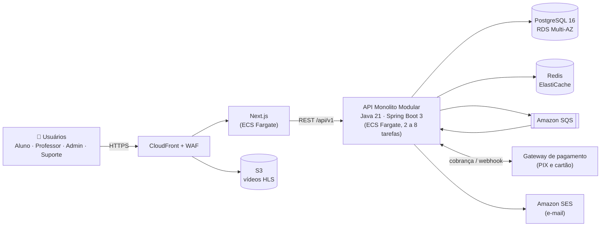

<div align="center">

# 🧭 Trilha Enem

**Seu caminho até a aprovação, passo a passo.**

Plataforma web de preparação para o Enem com aulas, simulados, correção de redação por rubrica, mentoria e um plano de estudos que se ajusta ao desempenho do aluno.


</div>

---

## 📌 Sumário

- [Sobre o projeto](#-sobre-o-projeto)
- [Status atual](#-status-atual)
- [Funcionalidades](#-funcionalidades)
- [Arquitetura](#-arquitetura)
- [Stack tecnológica](#-stack-tecnológica)
- [Estrutura do repositório](#-estrutura-do-repositório)
- [Como rodar](#-como-rodar)
- [Variáveis de ambiente](#-variáveis-de-ambiente)
- [Testes](#-testes)
- [CI/CD](#-cicd)
- [Contribuindo](#-contribuindo)
- [Roadmap](#-roadmap)
- [Metas de qualidade](#-metas-de-qualidade)
- [Documentação](#-documentação)
- [Equipe](#-equipe)
- [Licença](#-licença)

---

## 🎯 Sobre o projeto

O Enem 2025 teve **4,81 milhões de inscritos**, dos quais **63% eram isentos da taxa**. A maioria vem de escola pública, não tem acesso a cursinho caro e quase nunca recebe correção individual de redação. Além disso, a faixa etária mais numerosa tem 17 anos, o que exige atenção especial à proteção de dados (LGPD).

A **Trilha Enem** ataca dois problemas centrais:

1. **Falta de direção:** muito conteúdo e nenhuma priorização até a data da prova.
2. **Falta de feedback individual:** principalmente na redação.

**Proposta de valor:** em uma única plataforma, o aluno tem aulas, simulados com diagnóstico por área, correção de redação por rubrica e mentoria, tudo organizado em um **plano de estudos** (a "trilha") que se ajusta ao desempenho e à data da prova, por um preço acessível.

### Fora do escopo do MVP

Aplicativo mobile nativo (a versão web é responsiva), aulas ao vivo, correção de redação por IA, integração com SISU/inscrição oficial e marketplace aberto de professores.

---

## 🚧 Status atual

| Fase | Situação |
|---|---|
| Concepção, requisitos, arquitetura, UML, banco, infra, planejamento e qualidade (AID v1.0) | ✅ Concluída |
| Desenvolvimento do MVP (8 sprints de 2 semanas) | ⏳ Planejado para dez/2026 a abr/2027 |

> Este repositório nasce a partir do **Documento de Apoio (AID)** do projeto final de Análise e Projeto de Sistemas (UNIPÊ). Os comandos da seção [Como rodar](#-como-rodar) valem a partir da Sprint 1, quando `backend/`, `frontend/` e `infra/` receberem código.

---

## ✨ Funcionalidades

| # | Módulo | O que entrega |
|---|---|---|
| F1 | **Identidade e conta** | Cadastro, login com JWT, recuperação de senha, perfis e permissões, consentimento do responsável para menores de 18 anos, exportação e exclusão de dados (LGPD) |
| F2 | **Assinatura** | Planos Essencial e Completo, cancelamento com arrependimento em 7 dias, recibos |
| F3 | **Aulas** | Vídeo sob demanda com qualidade adaptativa (mínimo 360p), progresso e retomada |
| F4 | **Banco de questões** | Cadastro por área, habilidade e dificuldade |
| F5 | **Simulados** | Geração por área, tempo e dificuldade, cronômetro e salvamento automático a cada 30 s |
| F6 | **Desempenho** | Relatório por área e habilidade, nota estimada por acertos ponderados |
| F7 | **Redação** | Envio, fila de correção com prazo de 72 h e correção nas 5 competências (0 a 200 cada) |
| F8 | **Plano de estudos** | Cronograma semanal até a data da prova, priorizando as áreas mais fracas |
| F9 | **Mentoria** | Agendamento nos horários do professor, sem sobreposição |
| F10 | **Pagamentos** | PIX e cartão recorrente via gateway, webhook idempotente e conciliação |
| F11 | **Gestão** | Usuários, turmas e planos |
| F12 | **Suporte e painel** | Chamados com SLA de 24 h e painel de gestão (receita, inadimplência, usuários ativos) |

Todos os 34 requisitos funcionais (priorizados com MoSCoW) e os 12 não funcionais (todos com métrica) estão no AID.

---

## 🏗️ Arquitetura

A decisão central é um **monolito modular** (Spring Modulith) em vez de microserviços: com 1.000 req/s de pico e uma equipe de 5 pessoas, escalar a mesma aplicação horizontalmente atende bem, sem o custo de um banco, pipeline e rede por serviço.



### Módulos do monolito

`identidade` · `assinatura` · `conteudo` · `avaliacao` · `redacao` · `planoestudo` · `suporte` · `relatorios` · `notificacoes`

As dependências entre módulos apontam em uma única direção e só conversam por interfaces públicas e eventos de domínio.

### Decisões de arquitetura (ADR)

| ADR | Decisão |
|---|---|
| 001 | Monolito modular em vez de microserviços |
| 002 | Java 21 + Spring Boot 3 |
| 003 | Next.js com SSR/SSG nas páginas públicas |
| 004 | PostgreSQL em vez de MongoDB ou MySQL |
| 005 | REST/JSON com contrato OpenAPI 3.0 |
| 006 | AWS `sa-east-1` com ECS Fargate |
| 007 | Cache com Redis |
| 008 | Vídeo em S3 + CloudFront com URLs assinadas e HLS |
| 009 | Gateway de pagamento terceirizado atrás de um Adapter |
| 010 | Autenticação JWT sem estado (acesso de 15 min, refresh de 7 dias) |
| 011 | Processamento assíncrono com SQS |

### Padrões de design

Repository, Adapter, Strategy (nota estimada e plano de estudos), Factory (montagem do simulado), State (assinatura e redação) e Domain Events.

---

## 🛠️ Stack tecnológica

| Camada | Tecnologia |
|---|---|
| Frontend | Next.js, React, TypeScript |
| Backend | Java 21, Spring Boot 3, Spring Security, Spring Data JPA, Spring Modulith |
| API | REST/JSON, OpenAPI 3.0 |
| Banco de dados | PostgreSQL 16 (RDS Multi-AZ), Flyway |
| Cache | Redis (ElastiCache) |
| Mensageria | Amazon SQS |
| Vídeo e arquivos | Amazon S3 + CloudFront (HLS adaptativo) |
| Infraestrutura | AWS ECS Fargate, ALB, Route 53, WAF, Terraform |
| CI/CD | GitHub Actions |
| Observabilidade | CloudWatch, Micrometer |
| Testes | JUnit 5, Mockito, Testcontainers, Jest, Playwright, k6 |
| Segurança (pipeline) | CodeQL, Trivy, Dependabot, gitleaks, OWASP ZAP |

---

## 📁 Estrutura do repositório

```text
trilhaenem/
├── backend/          # Java 21 + Spring Boot (um pacote por módulo)
│   └── src/main/resources/db/migration/   # Migrations Flyway
├── frontend/         # Next.js + TypeScript (app/, components/, lib/)
├── infra/            # Terraform (rede, ECS, RDS, Redis, S3, CloudFront)
├── docs/
│   ├── AID_Trilha_Enem.pdf   # Documento de Apoio completo
│   ├── adr/                  # Registros de decisão de arquitetura
│   ├── diagramas/            # Fontes PlantUML
│   └── openapi.yaml          # Contrato da API
├── tests/
│   └── load/         # Testes de carga (k6)
├── .github/
│   └── workflows/    # Pipeline de CI/CD
├── docker-compose.yml
├── .env.example
└── README.md
```

---

## 🚀 Como rodar

### Pré-requisitos

- [Git](https://git-scm.com/)
- [Docker](https://docs.docker.com/get-docker/) 24 ou superior com Docker Compose
- JDK 21 e Node.js 22 (apenas para rodar fora do Docker)

### Em 5 passos

```bash
# 1. Clonar
git clone https://github.com/<seu-usuario>/trilhaenem.git
cd trilhaenem

# 2. Configurar variáveis de ambiente
cp .env.example .env
# edite o .env e troque DB_PASSWORD, JWT_SECRET e CPF_ENCRYPTION_KEY

# 3. Subir tudo (web, API, banco e Redis)
docker compose up --build
```

4. Acesse:

| Serviço | URL |
|---|---|
| Web | http://localhost:3000 |
| API | http://localhost:8080 |
| Documentação da API (Swagger) | http://localhost:8080/swagger-ui.html |
| Health check | http://localhost:8080/actuator/health |

5. Usuários de teste (criados pela migration de desenvolvimento): `aluno@teste.local`, `professor@teste.local` e `admin@teste.local` (a senha está no `.env.example`).

### Rodar só a infraestrutura e executar o código na máquina

```bash
docker compose up -d db redis

# backend
cd backend && ./mvnw spring-boot:run

# frontend (em outro terminal)
cd frontend && npm ci && npm run dev
```

---

## 🔐 Variáveis de ambiente

O arquivo `.env` **nunca** vai para o Git (está no `.gitignore`). Apenas o `.env.example` é versionado, sem valores reais.

| Grupo | Variáveis principais |
|---|---|
| Banco de dados | `DB_HOST`, `DB_PORT`, `DB_NAME`, `DB_USER`, `DB_PASSWORD` |
| Redis | `REDIS_HOST`, `REDIS_PORT` |
| Segurança | `JWT_SECRET`, `JWT_ACCESS_TTL_MINUTES`, `JWT_REFRESH_TTL_DAYS`, `CPF_ENCRYPTION_KEY` |
| Pagamento | `PAYMENT_GATEWAY_BASE_URL`, `PAYMENT_ACCESS_TOKEN`, `PAYMENT_WEBHOOK_SECRET` |
| AWS | `AWS_REGION`, `SQS_QUEUE_URL`, `SES_FROM_ADDRESS`, `VIDEO_CDN_BASE_URL`, `VIDEO_URL_SIGNING_KEY` |
| Frontend | `NEXT_PUBLIC_API_URL` |

Gere segredos fortes com `openssl rand -base64 48`. Em produção, os segredos vêm do **AWS Secrets Manager**. Em desenvolvimento, use credenciais de **sandbox** do gateway.

---

## 🧪 Testes

```bash
# Backend (unitários e integração com Testcontainers)
cd backend && ./mvnw verify

# Frontend
cd frontend && npm test

# Carga (meta: p95 abaixo de 300 ms)
k6 run tests/load/simulado.js
```

| Nível | Fatia | Ferramentas |
|---|---|---|
| Unitário | ~70% | JUnit 5, Mockito, Jest |
| Integração | ~20% | Spring Boot Test + Testcontainers (PostgreSQL e Redis reais) |
| Ponta a ponta | ~10% | Playwright |
| Contrato | n/a | Validação do OpenAPI |
| Carga | n/a | k6 (10.000 usuários simultâneos por 2 h) |
| Segurança | n/a | CodeQL, Trivy, OWASP ZAP |

---

## 🔄 CI/CD

Pipeline de 10 etapas no GitHub Actions:

| # | Etapa | Bloqueia quando |
|---|---|---|
| 1 | Lint (Checkstyle, ESLint, Prettier) | Qualquer erro |
| 2 | Testes unitários | Falha ou cobertura abaixo da meta |
| 3 | Build (Maven, `next build`, Docker multi-stage) | Falha de build |
| 4 | Testes de integração | Falha de teste |
| 5 | Segurança (CodeQL, dependências, Trivy, gitleaks) | Vulnerabilidade crítica ou alta |
| 6 | Publicação da imagem no ECR (tag = hash do commit) | Falha de push |
| 7 | Deploy em staging (Terraform, Flyway, ECS) | Falha de migration ou deploy |
| 8 | Smoke test | Qualquer falha dispara rollback automático |
| 9 | Aprovação humana | Sem aprovação não vai à produção |
| 10 | Deploy em produção (rolling update com circuit breaker) | Falha reverte para a versão anterior |

---

## 🤝 Contribuindo

O projeto segue **GitHub Flow**:

- A `main` é protegida e sempre implantável. Não há push direto.
- Branches curtas (máximo 3 dias), no formato `feat/RF018-salvar-lote`, `fix/webhook-duplicado` ou `chore/atualiza-dependencias`.
- Commits no padrão [Conventional Commits](https://www.conventionalcommits.org/pt-br/) (`feat:`, `fix:`, `docs:`, `test:`, `chore:`).
- Pull request obrigatório, com **1 aprovação** (**2** em pagamentos e segurança) e pipeline verde. Merge por *squash*.
- Releases marcadas com tag `vMAIOR.MENOR.PATCH`.

### Padrões de código (resumo)

- Domínio em português (`Aluno`, `Assinatura`, `Redacao`); termos técnicos de framework em inglês.
- Controller só traduz HTTP, regra de negócio no serviço, acesso a dados no repositório.
- DTOs como `record` imutáveis. Entidades JPA nunca saem na API.
- `@Transactional` nos serviços de caso de uso, nunca no controller.
- Logs em JSON com `correlation_id`. **Proibido** registrar senha, token ou CPF.
- Complexidade ciclomática máxima de 10 por método. TypeScript em modo `strict`, sem `any`.

Antes de contribuir, leia os ADRs em `docs/adr/` e o AID (seções 8.4 e 8.5).

### Definição de Feito (DoD)

Código revisado e mesclado, pipeline verde, testes cobrindo os critérios de aceite, migration versionada e compatível com a versão anterior, OpenAPI atualizado, campos PII marcados no dicionário de dados, implantação em staging com smoke test passando e validação do PO.

---

## 🗺️ Roadmap

| Sprint | Objetivo | Pontos |
|---|---|---|
| 1 | Infra, CI/CD e F1 (cadastro, consentimento, login) | 34 |
| 2 | F2 (planos e assinatura) e F3 (aulas) | 34 |
| 3 | F4 (banco de questões) e início de F10 (PIX e webhook) | 40 |
| 4 | Fim de F10 e F5 (geração e realização de simulado) | 40 |
| 5 | Fim de F5, F6 (desempenho) e início do plano de estudos | 40 |
| 6 | Fim do plano de estudos e F7 (redação) | 37 |
| 7 | F9 (mentoria) e F11 (gestão) | 34 |
| 8 | F12 (suporte e painel), qualidade, LGPD e testes de carga | 34 |

**Total:** 293 pontos para 320 de capacidade (velocidade estimada de 40 pontos por sprint). Início previsto em dezembro de 2026, com MVP pronto em abril de 2027.

---

## 📊 Metas de qualidade

| Requisito | Meta |
|---|---|
| Desempenho | p95 ≤ 300 ms em leituras e ≤ 500 ms em escritas com 10.000 usuários simultâneos |
| Disponibilidade | 99,9% por mês (infra composta estimada em 99,93%) |
| Recuperação | RPO ≤ 5 min, RTO ≤ 30 min |
| Segurança | TLS 1.2+, bcrypt (custo ≥ 12), 5 tentativas de login por minuto por IP, zero vulnerabilidades críticas ou altas no deploy |
| LGPD | 100% dos campos PII marcados, consentimento registrado para todos os menores, resposta ao titular em até 15 dias |
| Usabilidade móvel | LCP ≤ 2,5 s em 4G, layout a partir de 360 px |
| Acessibilidade | WCAG 2.1 nível AA, aulas com legendas |
| Cobertura de testes | ≥ 80% no domínio e ≥ 70% global |
| Correção de redação | Em até 72 h em 95% dos casos |

---

## 📚 Documentação

O **Documento de Apoio (AID v1.0)** reúne, em 9 blocos, tudo que um desenvolvedor precisa no dia 1:

| Bloco | Conteúdo |
|---|---|
| 1 | Concepção e escopo (visão, personas, stakeholders, viabilidade, riscos) |
| 2 | Requisitos (34 RFs, 12 RNFs, 15 histórias de usuário) |
| 3 | Arquitetura (11 ADRs, stack, padrões, modelo C4) |
| 4 | Diagramas UML (casos de uso, classes, sequência, componentes, deployment, atividades) |
| 5 | Banco de dados (modelo ER, lógico e físico, dicionário de dados, estratégia de dados e LGPD) |
| 6 | Infraestrutura e DevOps (rede, custos, SLA, pipeline, containerização, segurança, observabilidade) |
| 7 | Planejamento (WBS, estimativas, equipe e custo, matriz de riscos) |
| 8 | Documentação para o dev (README, `.env`, OpenAPI, padrões de código, Git workflow, Sprint 1) |
| 9 | Qualidade e processo (glossário, testes, DoR, DoD, Scrum com Kanban na operação) |

📄 [`docs/AID_Trilha_Enem.pdf`](docs/AID_Trilha_Enem.pdf)

> **Nota sobre os números:** o AID marca cada valor como **F** (fonte pública), **P** (premissa da equipe) ou **COTAR** (a confirmar em calculadora oficial ou pesquisa salarial). Os custos de infraestrutura e de equipe devem ser revalidados antes de qualquer decisão financeira.

---

## 👥 Equipe

Projeto final de **Análise e Projeto de Sistemas**, [UNIPÊ](https://unipe.br/) (Centro Universitário de João Pessoa).

| Papel | Nome |
|---|---|
| Analista / PO | José Felipe |
| Arquiteto de Software | Arionaldo Júnior |
| Engenheiro / DBA | Lucas Leal |

---

## 📄 Licença

Licença ainda não definida. Até que uma seja adicionada ao repositório, todos os direitos permanecem com os autores.

---

<div align="center">

Feito em João Pessoa, Paraíba 🌴

</div>